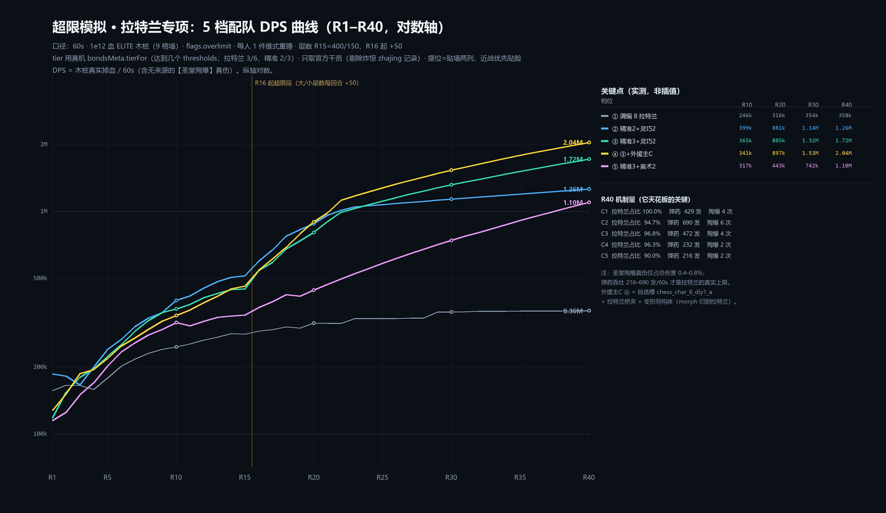

# 超限 · 拉特兰专项：精准 / 灵巧 × 新约能天使 + 蕾缪安

只读分析 + 出图。**没有改 `data/**`、`server/**`、`public/**`、`test/**`，没有 git 写操作，没有新增 `t('…')`。**
本轮唯一的源文件改动是 `tools/infinite-anchor-pairs.mjs`（修 `bondState()` 的 tier 口径 + 一条启动断言，见 §1）。
**卡西米尔本轮不跑**：8 锚对照只重跑了另外 7 条；卡西米尔保留已知值 0.257M 仅作参照。

交付物：

| 文件 | 内容 |
|---|---|
| 本文件 | 口径、对照、5 档结论 |
| [`handoff/shots/laterano-preci-skillful.png`](shots/laterano-preci-skillful.png) | 5 条 R1–R40 曲线（对数轴）+ R10/20/30/40 关键点表 + R40 机制量 |
| [`handoff/laterano-preci-skillful.csv`](laterano-preci-skillful.csv) | 5 档 × 40 回合：DPS、拉特兰占比、弹药、殉爆 |
| `.cache/o3/laterano.mjs`、`.cache/o3/chart-laterano.py` | 只读探针 / 出图脚本（`.cache/` 已被 gitignore；留着可复现，见 §5） |

> **一句话**：tier 修好后，把旧阵容/分格原样重跑**与已知真值逐位一致**（16.56/4.48/5.78/4.46/1.89/2.22/1.69，见 §1.2），
> 说明修的就是那一个 bug；但**全量重跑会重新选分格**，新 Top1 与已知真值表不是同一口径（§1.3）。
> 拉特兰专项里，合法摆位下 **C4（精准 3 档 + 灵巧 + 外援主 C）= 2.04M**，是 5 档最高；
> 旧口径（谢拉格+奥术）在同摆位只有 1.14M（+79%），但在锚定表原摆位下有 2.22M（−47%）——差异几乎全部来自摆位，见 §2.7。
> **圣堂殉爆仍然可以忽略**：最高 6 次/60s、真伤只占总伤害 0.4–0.8%；拉特兰的真实天花板是 216–690 发/60s 的弹药吞吐（§2.6）。

---

## 1. 第一件事：tier 口径 bug 的修复与对照

### 1.1 bug、修法、断言

`tools/infinite-anchor-pairs.mjs` 的 `bondState()` 以前按**人数**硬算档位：

```js
// 旧（错）
const bondState = (id, count, layers) => ({
  count, active: true, tier: Math.min(3, Math.max(1, count >= 6 ? 3 : count >= 4 ? 2 : 1)), layers,
});
```

真机的档位是**「达到了几个 thresholds」**（[`server/match/bondsMeta.js`](../server/match/bondsMeta.js) 的 `tierFor()`，
文件头注释第 23 行也写明 `tier = number of thresholds reached`）。拉特兰/叙拉古/卡西米尔 `thresholds = [3,6]`，
所以 **3 人 tier 1、4 人仍 tier 1、6 人才 tier 2**。旧写法 `count>=4 → 2` 等于「4 人就送 6 人档」；
战斗侧 `reached()`（[`server/sim/content/bonds/core.js`](../server/sim/content/bonds/core.js) 75–88 行）恰好有一条
`bondTier >= thresholds.indexOf(need)+1` 的捷径，于是**锚只占 4 格时 6 人档照样生效**。

修法：删掉人数硬算，直接调真机函数；并在模块加载时跑一条断言，把这个事实钉死：

```js
import { tierFor } from '../server/match/bondsMeta.js';

const bondState = (id, count, layers) => ({
  count, active: true, tier: tierFor(bonds[id], count), layers,
});

function assertTierCaliber() {
  const pinned = [
    ['lateranoShip', 3, 1], ['lateranoShip', 4, 1], ['lateranoShip', 5, 1], ['lateranoShip', 6, 2],
    ['siracusaShip', 4, 1], ['kazimierzShip', 4, 1], ['kjeragShip', 4, 1],
    ['egirShip', 5, 2], ['yanShip', 6, 2], ['yanShip', 9, 3],
    ['preciShip', 2, 1], ['preciShip', 3, 2], ['skillfulShip', 2, 1], ['arcaneShip', 3, 2],
    ['suntShip', 3, 1],
  ];
  for (const [id, count, want] of pinned) { /* 不等就 throw */ }
  // 再对 13 条池内盟约 × 人数 0–8 与真机 tierFor 逐例对拍
}
assertTierCaliber();
```

断言覆盖两层：15 个手写用例（把「4 人只有 tier 1」钉住）+ 池内每条盟约 × 0–8 人与 `tierFor` 的逐例同值
（将来 `data/bonds.json` 的 thresholds 变了，断言也会要求同源，不会悄悄漂移）。任何人把 tier 改回按人数硬算，脚本启动即抛。

### 1.2 对照 A：旧阵容/旧分格不动，只修 tier —— 与已知真值逐位一致 ✅

把**旧（错 tier）锚定报告** `.cache/o3/anchor-pairs.json` 里每锚 Top1 的 roster + 分格原样拿来，只把 tier 换成
`tierFor` 重跑 R40（同一木桩、装备、层数、`flags.overlimit`）：

| 锚 | 旧 Top1 搭档 / 分格 | 旧口径 R40 | 修 tier 后 R40 | 已知真值 | 对得上？ |
|---|---|---:|---:|---:|---|
| 谢拉格 | 灵巧 + 奥术（5/3/0） | 129.63M | **16.561M** | 16.56M | ✅ |
| 阿戈尔 | 谢拉格 + 奥术（4/4/0） | 51.88M | **4.475M** | 4.48M | ✅ |
| 萨尔贡 | 谢拉格 + 奥术（4/4/0） | 40.91M | **5.783M** | 5.78M | ✅ |
| 维多利亚 | 谢拉格 + 奥术（4/4/0） | 26.44M | **4.462M** | 4.46M | ✅ |
| 炎 | 谢拉格 + 奥术（4/4/0） | 22.02M | **1.885M** | 1.89M | ✅ |
| 拉特兰 | 谢拉格 + 奥术（4/4/0） | 13.81M | **2.222M** | 2.22M | ✅ |
| 叙拉古 | 维多利亚 + 奥术（4/4/0） | 8.41M | **1.689M** | 1.69M | ✅ |
| 卡西米尔 | （本轮不跑） | 4.67M | — | 0.257M | — |

**7/7 全部吻合到给出的有效数字**。所以「修完对不上」的担心可以排除：tier 这一处已经修对了。

### 1.3 对照 B：全量重跑（重新选分格）—— 与已知真值**不是同一口径**

`node tools/infinite-anchor-pairs.mjs <7 锚> --tag tierfix`（462 组 × 29 场，938 秒）会**重新跑 9 套分格选最优**，
而不是沿用旧阵容。修 tier 后，「把锚堆到 6 人开 6 档」第一次变成一件真正值得做的事，最优分格因此整体从 4/4/0
移向 6/2/0 或 3/3/2：

| 锚 | 新 Top1（重跑） | 分格 | R30 | R40 | 已知真值（旧阵容） | 差异原因 |
|---|---|---|---:|---:|---:|---|
| 谢拉格 | 迅捷 + 奥术 | 6/2/0 | 13.807M | **40.293M** | 16.56M | 旧阵容是 5/3/0（谢拉格 5 人 = tier 1，没寒霜风） |
| 阿戈尔 | 谢拉格 + 奥术 | 5/3/0 | 2.134M | **4.480M** | 4.48M | 同一套，恰好没变 |
| 萨尔贡 | 谢拉格 + 奥术 | 5/3/0 | 2.673M | **6.145M** | 5.78M | 分格 4/4/0 → 5/3/0 |
| 维多利亚 | 精准 + 奥术 | 4/2/2 | 6.280M | **18.289M** | 4.46M | 旧阵容是谢拉格+奥术 4/4/0 |
| 炎 | 维多利亚 + 奥术 | 6/2/0 | 1.801M | **4.449M** | 1.89M | 6 人档第一次值得拿 |
| 拉特兰 | 维多利亚 + 精准 | 3/3/2 | 1.449M | **2.775M** | 2.22M | 旧阵容谢拉格+奥术 4/4/0 |
| 叙拉古 | 维多利亚 + 奥术 | 6/2/0 | 5.980M | **6.097M** | 1.69M | 旧 4/4/0 只有 tier 1；6 人档是它的全部引擎 |

**这就是「另一处口径差」，必须先报**：已知真值表是「旧阵容/旧分格 + 只修 tier」的**混合口径**，
它既不是旧口径（旧口径是 129.63M 那列），也不是修完之后的真实最优。要横向比较，两边必须同时重跑；
只重跑一边、另一边沿用旧阵容，得到的倍数没有意义。

两个附带发现（**只报不改**，因为本轮只授权改 tier）：

1. **池子里混进了炸惊记录**。`data/chess.json` 里带 `zhajing: true` 的 `chess_zj_*` 是炸惊模拟的叠加记录，
   官方难度下 `GameData` 会按 `'zhajing' in c` 全部剔除；锚定脚本直接读 JSON，没有这一层过滤。
   后果是 roster 里会出现**同一干员的两个记录**（旧拉特兰 Top1：`chess_char_6_01_b` + `chess_zj_78_b` 两个蕾缪安、
   `chess_char_6_02_b` + `chess_zj_79_b` 两个圣聆初雪、`chess_char_4_02_b` + `chess_zj_47_b` 两个莫斯提马），
   既白拿人数又白拿伤害。§1.2 的复现之所以能对上已知真值，正是因为两边都用了同一份含炸惊记录的 roster。
   拉特兰专项已经剔除它们（§2.1），锚定脚本的池子过滤建议下一轮单独修。
2. **锚定摆位有「干员与木桩同格」**。脚本把 8 人放在 row 10、col 3–10，而木桩墙是 row 9–11 × col 8–10，
   于是第 6–8 人**站在木桩格子上**打（相当于 0 距离），真实对局不可能这样部署。§2 的专项为此另设了合法摆位，
   并在 §2.7 给出两种摆位的对照。

### 1.4 卡西米尔

按要求本轮不跑：**没有做 66 组搭档扫描、也没有 Top1**。唯一被跑到的是脚本共享的「8 锚 × 21 点单锚基线」循环
（它的结果只用于给搭档排序，不产生任何卡西米尔结论，21 场 60 秒木桩）。
已知值 0.257M（修 tier 后）保留在表里仅作参照，未参与任何新计算。

---

## 2. 拉特兰专项

### 2.1 主 C 的 chessId（同名候选全部列出）

`data/chess.json` 按 `name` 精确匹配，两个名字都各有 **2 个候选**（官方记录 + 炸惊叠加记录）：

| 名字 | 官方记录（本轮采用） | 炸惊记录（剔除） | 匹配依据 |
|---|---|---|---|
| 新约能天使 | **`chess_char_6_13_b`** | `chess_zj_87_b` | 名字精确相等；`zhajing` 标记 false vs true；两者 `baseId` 不同（`chess_char_6_13_a` / `chess_zj_87_a`） |
| 蕾缪安 | **`chess_char_6_01_b`** | `chess_zj_78_b` | 同上（`chess_char_6_01_a` / `chess_zj_78_a`） |

选官方记录的理由：超限（`solo_infinite`）走的是官方难度数据，`server/match/gamedata.js` 对非炸惊模式会把
`zhajing: true` 的记录全部过滤掉，炸惊记录在超限局里**根本不存在**。两条官方记录的 `bonds` 分别是
`["lateranoShip"]`（新约能天使）和 `["lateranoShip","preciShip"]`（蕾缪安，天然同时覆盖两支搭档中的精准）。

> 炸惊变体的差别：`chess_zj_87_b` 的 bonds 是 `lateranoShip+penguinShip+preciShip`（多两条），
> `chess_zj_78_b` 与官方蕾缪安同 bonds。若把炸惊记录也算进池子，精准/拉特兰的人数会白涨（§1.3 发现 1），
> 所以本轮 5 档全部用官方记录。

### 2.2 5 档阵容（8 格 / 7 常驻 + 1 外援）

固定骨架 = 6 名拉特兰：新约能天使、蕾缪安、送葬人、空弦、莫斯提马、能天使。
主 C 两人（新约能天使 + 蕾缪安）**每一档都在场**。

| 档 | 阵容（8 格） | 实际人数（引擎成员判定） | 说明 |
|---|---|---|---|
| **C1** 基线 | 上述 6 人 + 圣约送葬人 + 隐现 | 拉特兰 **8** | 满编，无搭档，无外援 |
| **C2** 精准 2 + 灵巧 2 | 上述 6 人 + 阿斯卡纶（灵巧） + 圣约送葬人（拉特兰，第 8 格） | 拉特兰 **7** / 精准 **2**（蕾缪安 + 送葬人） / 灵巧 **2**（空弦 + 阿斯卡纶） | 两支搭档都只放**最少人数激活** |
| **C3** 精准 3 + 灵巧 2 | 上述 6 人 + 远牙（精准） + 阿斯卡纶（灵巧） | 拉特兰 **6** / 精准 **3** / 灵巧 **2** | 精准堆到**它能到的最高档 = 第 2 档（3 人）**；用 3 个位置，其中 2 个同时是拉特兰（蕾缪安、送葬人） |
| **C4** 同 C3 + 外援主 C | 上述 6 人 + 维什戴尔（精准+灵巧，一格拉两盟约） + **菲亚梅塔**（自选槽） | 拉特兰 **7**（含外援） / 精准 **3** / 灵巧 **2** | 7 常驻 + 1 外援；外援经「拉特兰桥夹 + 变形同构体」归到拉特兰（引擎 `unitBonds` 实测 = `lateranoShip`） |
| **C5** 精准 3 + 奥术 2（对照） | 上述 6 人 + 远牙（精准） + 深靛（精准+奥术） | 拉特兰 **6** / 精准 **4**（≥3 即第 2 档） / 奥术 **2**（莫斯提马 + 深靛） | 相对 C3 只把灵巧换成奥术 |

**关于 C3 的「精准堆高层」**：精准 `thresholds = [2,3]`，最高档是**第 2 档（3 人）**，不是第 3 档——数据里只有两档。
这 3 个位置里 2 个（蕾缪安、送葬人）本来就带拉特兰，所以实际只多花 1 格：C2 → C3 把第 8 格的圣约送葬人（拉特兰）
换成远牙（精准），拉特兰 7 → 6（仍 ≥6，6 人档不掉）。
**「8 格内堆不到高档」不成立**：第 2 档只要 3 人，8 格里完全放得下。

**C4 的 7 常驻为什么必须用维什戴尔**：7 格里要同时保住拉特兰 6 人档 + 精准 3 人 + 灵巧 2 人，
6 名拉特兰已经占 6 格，剩下 1 格必须同时是精准和灵巧——只有维什戴尔（`preciShip + skillfulShip`）能一格顶两格。
外援选**菲亚梅塔**（`char_300_phenxi`，87 名自选里**唯一**拉特兰籍）：它自己的 bonds 就是 `lateranoShip`，
再走同一条 `[拉特兰桥夹 + 变形同构体]` 转职路径（`unitBonds` 实测仍含 `lateranoShip`）。
换用工具默认的维什戴尔当外援会与第 7 常驻重复（同一干员上两次），R40 高 12%（2.284M vs 2.043M），
外援候选实测排名见 §2.8。

### 2.3 口径

| 项 | 取值 |
|---|---|
| 战场 | 60 秒；1e12 血、0 防、0 攻、`rank: ELITE` 的 9 个木桩（row 9–11 × col 8–10） |
| 超限 | `flags.overlimit = true`（五条 2026-10-19 超限专属加强只在这个 flag 下生效） |
| 装备 | 每人 1 件维式重锤 `chess_item_1_01_e_a`；外援另带 `chess_item_4_08_e_a` + `chess_item_6_09_e_b` |
| 层数 | R15 = 大 400 / 小 150，R16 起每回合各 +50；R1–R15 线性累积（与锚定报告 v2 同口径） |
| tier | `bondsMeta.tierFor()`（达到几个 thresholds）；绝技 `suntShip` 与锚定脚本同口径（count 3 / 小层数） |
| 干员池 | 只取官方记录（剔除 `zhajing: true`），同 `baseId` 只留精锐 `_b` |
| **摆位** | **合法摆位**：贴住木桩墙的紧凑两列 col 7 / col 6（row 9–12，不与木桩同格），近战优先拿 col 7 的贴脸位；另在 §2.9 给出锚定表原摆位（row 10, col 3–10）的敏感度 |
| DPS | `dps_total` = Σ 木桩 `stats.taken` / 60（**含**无来源的圣堂殉爆真伤）；`dps_credited` = `perPlayer.damageDealt` / 60（锚定表同口径，**不含**殉爆） |
| 拉特兰占比 | (拉特兰成员伤害 + 殉爆真伤) / dps_total；成员判定用引擎 `support.isMember`，token 记到 owner |
| 弹药 | `ammoUsed` 事件数，只算引擎 `memberSet` 里的拉特兰成员（外援转职后也算） |
| 殉爆 | `floor(弹药 / 100)`（每累计 100 发一次）；另用 `hpChanged` 里 `source/credit` 皆空的真伤实例交叉验证 |

### 2.4 结果表（R10 / R20 / R30 / R40）

DPS 为 `dps_total`（含殉爆），括号内为 `dps_credited`：

| 档 | R10 | R20 | R30 | R40 | R40 拉特兰占比 | R40 弹药 | R40 殉爆 |
|---|---:|---:|---:|---:|---:|---:|---:|
| C1 满编 | 0.246M (0.243M) | 0.316M (0.311M) | 0.354M (0.347M) | **0.358M** (0.351M) | 100.0% | 429 | 4 |
| C2 精准2+灵巧2 | 0.399M (0.394M) | 0.881M (0.871M) | 1.137M (1.124M) | **1.261M** (1.246M) | 94.7% | 690 | 6 |
| C3 精准3+灵巧2 | 0.365M (0.362M) | 0.805M (0.797M) | 1.318M (1.307M) | **1.718M** (1.703M) | 96.8% | 472 | 4 |
| C4 同 C3 + 外援 | 0.341M (0.340M) | 0.897M (0.892M) | 1.533M (1.526M) | **2.043M** (2.034M) | 96.3% | 232 | 2 |
| C5 精准3+奥术2 | 0.317M (0.315M) | 0.443M (0.439M) | 0.742M (0.737M) | **1.098M** (1.091M) | 90.0% | 216 | 2 |

殉爆真伤绝对值（R40）：C1 0.391M / C2 0.902M / C3 0.884M / C4 0.518M / C5 0.443M，
占各自总伤害 **0.4%–0.8%**——即使把弹药堆到 690 发，殉爆也只是零头。

> 「拉特兰占比」接近 100% 是阵容构成的必然（6–8 名拉特兰在场），不代表拉特兰这条盟约强；
> 真正要看的是绝对 DPS，以及搭档带来的增量（§2.10）。C1 是「只有拉特兰」的纯度参照。

### 2.5 曲线与 CSV



- 曲线在 **R16 之前**（层数线性累积段）都还贴着，**R16 之后**（每回合 +50）开始拉开：
  精准的 ATK 乘区与灵巧的 ASPD 都随层数线性放大，而拉特兰自己的弹药乘区在 600 层就封顶（R20 左右就吃满）。
- C1 在 R30 之后基本走平（429 发、+700% 攻击上限、弹药 ×10.05 全部封顶），这就是「拉特兰自己」的天花板。

CSV 列：`config,round,dps_credited,dps_total,laterano_share,laterano_damage,ammo_used,blast_triggers,blast_hits,laterano,preci,skillful,arcane`，
5 档 × 40 回合 = 200 行，全部是**实测点，不是插值**。

### 2.6 R40 归因：拉特兰的伤害到底谁打的

| 单位 | C1 | C2 | C3 | C4 | C5 |
|---|---:|---:|---:|---:|---:|
| 新约能天使（主 C，弹药 146–402） | 8.87M | 21.36M | 44.42M | 20.64M | 18.04M |
| 蕾缪安（主 C，弹药 50–86） | 7.56M | 23.25M | 17.52M | 22.71M | 18.83M |
| 送葬人 | 0.40M | 6.68M | 1.36M | 18.16M | 3.15M |
| 空弦 | 0.96M | 8.82M | 26.89M | 26.24M | 2.84M |
| 莫斯提马 | 0.38M | 2.51M | 6.34M | 1.01M | 13.73M |
| 能天使 | 0.76M | 0.63M | 2.38M | 11.54M | 2.24M |
| 圣约送葬人（弹药 7–238） | 0.15M | 7.52M | — | — | — |
| 隐现（弹药 226） | 2.02M | — | — | — | — |
| 阿斯卡纶（灵巧） | — | 4.01M | 2.71M | — | — |
| 远牙（精准） | — | — | 0.58M | — | 0.57M |
| 维什戴尔（精准+灵巧） | — | — | — | 4.50M | — |
| 菲亚梅塔（外援，转职拉特兰） | — | — | — | 17.25M | — |
| 深靛（精准+奥术） | — | — | — | — | 6.05M |

几点：

- **弹药几乎全部由 3–4 个人贡献**：隐现（226）、新约能天使（146–402）、蕾缪安（50–86）、圣约送葬人（7–238）。
  C1 的 429 发 = 隐现 226 + 新约 146 + 蕾缪安 50 + 圣约 7（逐发对得上）；C2 的 690 发里新约能天使一人 402、圣约 238。
  **换掉一个弹药型干员，殉爆次数立刻塌下来**（C2 690 发 6 次 → C4 232 发 2 次）——这就是弹药/殉爆在 5 档里差别这么大的原因。
- C4 的外援菲亚梅塔一个人打 17.25M（占全队 14%），是 5 档里单点最高的非主 C 单位。
- C5 的莫斯提马 13.73M 来自奥术的「受到法术伤害提升」+ 奥术自身法伤乘区；但奥术只强化 2 个奥术成员，
  不像灵巧/精准那样铺到全队。

### 2.7 「主 C 换成新约能天使+蕾缪安」相对旧口径（谢拉格+奥术）的变化

旧口径 = 修 tier 后拉特兰锚的**已知真值 Top1**：谢拉格 + 奥术，分格 4/4/0，R40 = **2.222M**。
同一套 roster 在两种摆位下重跑：

| 口径 | R10 | R20 | R30 | R40 |
|---|---:|---:|---:|---:|
| 旧 Top1（谢拉格+奥术）· 锚定表原摆位 | 0.090M | 0.31M | 1.01M | **2.222M** |
| 旧 Top1（谢拉格+奥术）· 合法摆位 | 0.060M | 0.18M | 0.54M | **1.14M** |

新 5 档（合法摆位）相对旧 Top1：

| 档 | 合法摆位 R40 | vs 旧 1.14M（合法） | 锚定原摆位 R40 | vs 旧 2.22M（原摆位） |
|---|---:|---:|---:|---:|
| C1 满编 | 0.358M | 0.31× | 0.301M | 0.14× |
| C2 精准2+灵巧2 | 1.261M | 1.11× | 1.007M | 0.45× |
| C3 精准3+灵巧2 | 1.718M | 1.51× | 1.158M | 0.52× |
| **C4 同 C3 + 外援** | **2.043M** | **1.79×** | 1.186M | 0.53× |
| C5 精准3+奥术2 | 1.098M | 0.96× | 1.169M | 0.53× |

**两个结论同时成立，必须分开读**：

1. **同一合法摆位下，新主 C 体系全面超过旧 Top1**：C4 = 2.043M vs 旧 1.14M，**+79%**；
   C3 也有 +51%。说明「新约能天使 + 蕾缪安 + 精准 + 灵巧」这套组合本身是更强的拉特兰阵容。
2. **在锚定表的原摆位下，旧 Top1 的 2.22M 反而更高**（新 C4 只有 1.19M）。原因不是数值，而是摆位：
   原摆位把第 6–8 人放在木桩格子上（0 距离输出），旧阵容恰好有 3 个这样的位置；合法摆位下它们的收益消失，
   同一套旧阵容从 2.22M 掉到 1.14M（−49%）。**拿 2.22M 当基准去比新阵容，会得到相反的结论。**

另外，旧 Top1 的 roster 本身含 3 组炸惊重复（§1.3 发现 1），官方难度下这 8 人实际只能上 5 个不同干员，
所以 2.22M 这个数本身也是虚的。**建议后续统一用「官方池 + 合法摆位」这个口径重做锚定表。**

### 2.8 外援主 C 候选（R40，C4 阵容，合法摆位）

| 候选 | R40 总 DPS | 备注 |
|---|---:|---|
| 维什戴尔 `char_1035_wisdel` | 2.284M | 与第 7 常驻重复（同一干员上两次），不采用 |
| **菲亚梅塔 `char_300_phenxi`** | **2.043M** | **采用**：87 名自选里唯一拉特兰籍，不重复 |
| 提丰 `char_2012_typhon` | 1.968M | |
| 逻各斯 `char_4133_logos` | 1.895M | |
| 澄闪 `char_377_gdglow` | 1.893M | |
| 真言 `char_4204_mantra` | 1.880M | |
| 鸿雪 `char_4055_bgsnow` | 1.884M | |
| 假日威龙陈 `char_1013_chen2` | 1.814M | |
| 艾雅法拉 / 刻俄柏 / 娜仁图亚 / 莱伊 / 黑 / 薇薇安娜 / 阿斯卡纶 / 谬因 / 涤火杰西卡 / 伊芙利特 | 1.75–1.83M | 差距在 ±5% 内 |

所有候选都被引擎判定为拉特兰成员（`diy_bonds = ["lateranoShip"]`），证明 morph 转职路径生效。

### 2.9 摆位敏感性（同一套 5 档，锚定表原摆位 row 10 / col 3–10）

| 档 | 合法摆位 R40 | 原摆位 R40 | 原摆位弹药 | 原摆位殉爆 |
|---|---:|---:|---:|---:|
| C1 | 0.358M | 0.301M | 316 | 3 |
| C2 | 1.261M | 1.007M | 287 | 2 |
| C3 | 1.718M | 1.158M | 50 | 0 |
| C4 | 2.043M | 1.186M | 50 | 0 |
| C5 | 1.098M | 1.169M | 50 | 0 |

原摆位下 C3/C4 的弹药只有 50 发（新约能天使打不到木桩 → 没有 SP → 弹药技能放不出来），
殉爆直接归零；C5 反而略高（奥术不依赖远程覆盖）。这再次说明**原摆位不适合评估拉特兰**。

### 2.10 「精准堆高层 vs 灵巧」哪个更划算

用两组同阵容、只差一个变量的实测来回答：

| 对比 | 变量 | 合法摆位 | 原摆位 |
|---|---|---:|---:|
| C2 → C3 | 精准 2 档 → 3 档（最高档），花 1 格（圣约送葬人 → 远牙），拉特兰 7 → 6（仍 6 人档） | **+36.2%**（1.261 → 1.718M） | +15.0%（1.007 → 1.158M） |
| C3 → C5 | 灵巧 2 人 → 奥术 2 人（同样花 2 格） | **−36.1%**（1.718 → 1.098M，即灵巧比奥术高 56.5%） | +0.9%（基本打平） |

**结论：精准堆到第 2 档更划算，而且更稳。**

- 精准第 2 档不是「多一点攻击力」，而是**把生效范围从「精准干员」扩到「所有远程干员」**。
  这套阵容 8 人里 6–7 人是远程，等于全队吃到 `+10% + 1.2%×层数`（R40 = **+1690% 攻击力**）；
  而攻击力会**逐发子弹**放大，正好乘在拉特兰的弹药伤害上。两种摆位下都是正收益（+36% / +15%）。
- 灵巧的收益只有 **ASPD `+10 + 1×层数`**（R40 = **+1410**），而且只作用于「灵巧干员周围 4 格/8 格」。
  它对**普攻型**单位（空弦、送葬人）是巨大乘区（C3 里空弦 26.9M），但对**弹药技能**只是让子弹打得更快、
  不增加每发伤害，所以对拉特兰主 C 的帮助有限。更关键的是它**完全依赖站位聚集**：
  合法紧凑摆位下灵巧比奥术高 56.5%，锚定表的散线摆位下两者打平（+0.9%）。
- 因此：**先买精准第 2 档（1 格，结构性质变），再考虑灵巧**；灵巧只有在「队伍挤在灵巧干员周围」时才值这 2 格。
  两样都要的话就是 C3/C4，其中 C4（外援菲亚梅塔）是 5 档上限。

---

## 3. 产物与复现

```bash
# 1) tier 对照 A：旧阵容/旧分格 + tierFor（应逐位复现 16.56 / 4.48 / 5.78 / 4.46 / 1.89 / 2.22 / 1.69）
node .cache/o3/laterano.mjs --repro .cache/o3/anchor-pairs.json

# 2) tier 对照 B：7 锚全量重跑（重新选分格；约 16 分钟）
node tools/infinite-anchor-pairs.mjs kjeragShip,egirShip,sargonShip,victoriaShip,yanShip,lateranoShip,siracusaShip --tag tierfix

# 3) 拉特兰专项 5 档 × R1–R40（合法摆位，写 handoff/laterano-preci-skillful.csv）
node .cache/o3/laterano.mjs --run --layout block --diy char_300_phenxi

# 4) 摆位敏感度（原摆位，只写 .cache）
node .cache/o3/laterano.mjs --run --layout row --diy char_300_phenxi --tag row

# 5) 旧 Top1 两种摆位
node .cache/o3/laterano.mjs --oldtop .cache/o3/anchor-pairs.json

# 6) 出图
python .cache/o3/chart-laterano.py
```

- 临时脚本都在 `.cache/o3/`（gitignore），**没有**改动 `data / server / public / test`。
- `.cache/o3/anchor-pairs.json` 是**旧口径**（错 tier）的 528 组结果，保留下来做 §1.2 的复现基准；
  `.cache/o3/anchor-tierfix.json` 是本轮 7 锚重跑结果。两者都在 `.cache` 里，不进 git。

## 4. 本轮改动清单

| 文件 | 改动 |
|---|---|
| `tools/infinite-anchor-pairs.mjs` | `bondState()` 改为 `tierFor(bonds[id], count)`；新增 `assertTierCaliber()` 启动断言（15 个手写用例 + 池内盟约 × 0–8 人对拍）；顶部加一段说明注释。其余逻辑（分格搜索、roster、木桩、层数、外援、金锤、CSV/JSON 导出）未动。 |

`tools/infinite-teams.mjs` 里有一份写法相同的 `bondState()`，但它的锚 `count` 一律封顶 6（8 人队 / 7+1 外援队都 ≥6），
当前不会触发同一个 bug，本轮未改；若以后允许锚少于 6 人，应同样改成 `tierFor`。

没有新增 `t('…')`，没有改 `data/**`，没有 git 写操作。
