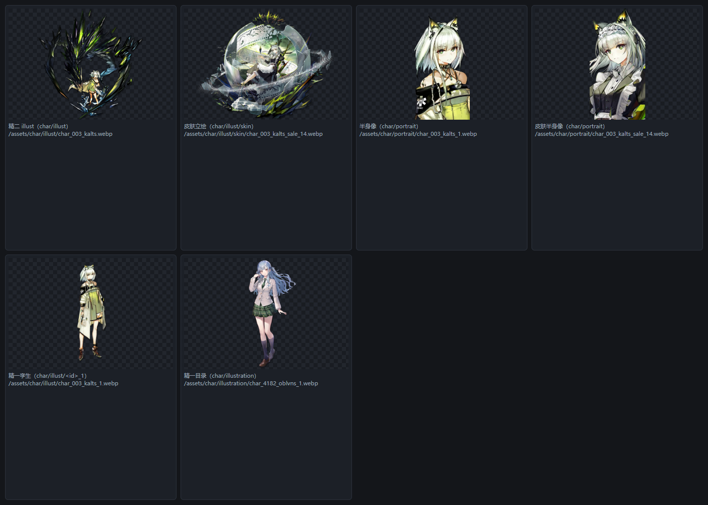

# 立绘类素材 PNG → WebP 正式转换 · CONVERT-REPORT

生成：2026-10-31　·　仓库：`E:\Workbox\系统`　·　业主已批准开工
参数（定稿）：**`quality=90` + `method=6` + `alpha_quality=100` + `exact=False`**
依据：[`MEASURE.md`](MEASURE.md)、[`illust-e1/E1-COMPARE.md`](illust-e1/E1-COMPARE.md)、
[`extended/EXTENDED-PLAN.md`](extended/EXTENDED-PLAN.md)。原件备份与恢复：[`BACKUP.md`](BACKUP.md)。

一句话结论：**四个目录 1948.25 MiB → 511.42 MiB，省 1436.83 MiB（73.7%）**，1273 张转成 WebP、249 张仍是 PNG
（13 张白名单 + 236 张逐张校验没过的回退），**1509 张的 alpha 全部 maxdiff = 0**，管线与清单已切到 `.webp`，
真服务端 + puppeteer 抽测 6 张 WebP + 2 张白名单 PNG 全部 HTTP 200 / 解码正常 / 控制台 0 报错。

---

## 1. 四目录体积表（实测，不是外推）

| 目录 | 转前 | 转后 | 占比 | 省下 | 转成 WebP | 白名单 PNG | 校验回退 PNG |
|---|---:|---:|---:|---:|---:|---:|---:|
| `char/illust`（精二 + 精一 `_1` 孪生） | 912.23 MiB | **211.31 MiB** | 23.2% | **700.92 MiB** | 448 | 0 | 30 |
| `char/illust/skin`（皮肤立绘） | 886.04 MiB | **210.88 MiB** | 23.8% | **675.16 MiB** | 259 | 5 | 13 |
| `char/illustration`（精一 `_1`/`_2`/`_skin1`） | 63.59 MiB | **52.47 MiB** | 82.5% | **11.12 MiB** | 7 | 8 | 0 |
| `char/portrait`（半身像 180×360） | 86.39 MiB | **36.76 MiB** | 42.5% | **49.63 MiB** | 559 | 0 | 193 |
| **合计** | **1948.25 MiB** | **511.42 MiB** | **26.3%** | **1436.83 MiB** | **1273** | **13** | **236** |

- 「转后」= 该目录现在磁盘上的全部字节（WebP + 仍是 PNG 的那些）。
- 只统计**实际转成 WebP 的 1273 张**：**1757.46 MiB → 320.63 MiB（18.2%，5.48×）**。
- `data/assets.json` 的 `stats.bytes`（它统计全清单，含音频 / Spine）：**3,117,472,729 → 1,622,611,069 B
  （−1425.5 MiB）**；`public/assets` 整棵树 **3998.4 MiB → 2241.0 MiB**。

### 1.1 与任务表的对应（口径差异要看清）

任务表按 `E1-COMPARE.md` 的口径写的是「精二 233 张 / 717.06 MiB」，本次实测 **237 张 / 726.03 MiB**（测量之后上游又
补了 4 张）。另外 `char/illust/` 里还有 **241 张 `_1` 精一同目录孪生**（186.20 MiB）—— 它们和精二同一目录、同一套
引用（座位名片的精一/精二开关），所以一起转了：

| 细分 | 张数 | 转前 | 转后 | 省 |
|---|---:|---:|---:|---:|
| `char/illust/*`（精二，无后缀） | 237 | 726.03 MiB | 162.13 MiB | 563.90 MiB |
| `char/illust/*_1`（精一孪生） | 241 | 186.20 MiB | 49.18 MiB | 137.02 MiB |

`char/portrait` 的 86.39 → 36.76 MiB 高于 `EXTENDED-PLAN` 的估算（21.57 MiB）：193 张 180×360 半身像在 q90 下
只有 28.8–33.9 dB，按第 2 节的档位判定不合格，回退成 PNG 了（回退清单见 §2.3）。

---

## 2. 逐张校验

### 2.1 alpha：位级无损（硬门槛）

**1509/1509 张 alpha 通道最大差 = 0**（含回退的那些），0 例非零。编码失败 0 例。
`alpha_quality=100` 没有被覆盖，与 `MEASURE.md` §8 / `EXTENDED-PLAN.md` §2.3 的结论一致。

### 2.2 PSNR：按 `EXTENDED-PLAN.md` §6.4 的档位判定

度量口径与报告一致：先按 alpha 合成到中性灰 `#808080`，再 LANCZOS 重采样到目标宽度，RGB 上算 PSNR。
**口径自校准**：拿 3 张已知结果的图重算，与 `E1-COMPARE.md` / `EXTENDED-PLAN.md` 的表相差 ≤ 0.45 dB
（`char_4183_mortis_2` 39.45 dB、`char_4186_tmoris_2` 45.22 dB、`char_1035_wisdel_sale_14` 48.23 dB）；
再用 **Chrome 自己的解码器**独立复算 3 张（`char_102_texas` 38.35、`char_332_archet` 39.32、`char_1046_sbell2` 43.69 dB，
canvas `drawImage` 双线性而不是 LANCZOS，所以系统性高 0.5–0.8 dB），结论一致。

| 显示档 | 判定线（§6.4） | 本次怎么用 |
|---|---|---|
| 792 px 宽（1× 手机铺满） | 通过 ≥ 45 dB；可接受 ≥ 40 dB；**不通过 < 40 dB** | 宽 ≥ 792 px 的图（会在 792 宽的屏上铺满）按这条判 |
| 全分辨率（1:1） | 通过 ≥ 40 dB；可接受 ≥ 34 dB；**不通过 < 34 dB** | 宽 < 792 px 的图（180×360 半身像，原生尺寸就是显示尺寸）按这条判 |
| 2376 px 宽（DPR3） | 通过 ≥ 40 dB；可接受 ≥ 36 dB；不通过 < 36 dB | 只用于挑选白名单（§6.4 的 13 张），本次不逐张判 |

**结果：1273 张通过（保留 WebP），236 张不通过（回退 PNG）。**

保存下来的 1273 张：

| 指标 | 值 |
|---|---|
| PSNR@792 | 最低 34.41 / p10 35.54 / **中位 41.45** / 最高 50.06 dB |
| PSNR@1:1 | 最低 32.97 / **中位 38.41** / 最高 47.80 dB |
| alpha maxdiff ≠ 0 | **0 张** |

> 口径提醒：`PSNR@1:1` 最低 32.97 dB 的那些是**大图**（本来就低于 34 dB 的 1:1 档），它们在 792 显示档上是合格的
> —— 这正是 §6.4 分档的本意（PSNR 随显示尺寸缩小而上升）。

### 2.3 回退清单（236 张 / 110.15 MiB，完整逐张表见 `verify/reverted.tsv`）

| 目录 | 回退张数 | 体积 | 判定档 |
|---|---:|---:|---|
| `char/illust` | 30 | 48.76 MiB | 792 px 档 < 40 dB |
| `char/illust/skin` | 13 | 37.94 MiB | 792 px 档 < 40 dB |
| `char/portrait` | 193 | 23.44 MiB | 1:1 档 < 34 dB |
| `char/illustration` | 0 | — | — |

**最大的 10 张回退**（都是「噪点 / 拼贴 / 辉光」画风，与 `MEASURE.md` §6 对 `char_4137_udflow` 的分析同源）：

| 文件 | 分辨率 | PSNR@792 | PSNR@1:1 | 原体积 |
|---|---|---:|---:|---:|
| `char/illust/char_437_mizuki` | 2142×2484 | 38.10 | 30.53 | 7.72 MiB |
| `char/illust/skin/char_377_gdglow_summer_12` | 1951×2032 | 38.87 | 33.23 | 5.44 MiB |
| `char/illust/skin/char_4011_lessng_whirlwind_7` | 1893×2048 | 34.56 | 28.85 | 4.80 MiB |
| `char/illust/char_4191_tippi` | 1918×1793 | 38.29 | 32.67 | 4.80 MiB |
| `char/illust/skin/char_437_mizuki_game_6` | 1911×1721 | 37.42 | 31.23 | 4.78 MiB |
| `char/illust/skin/char_377_gdglow_sanrio_1` | 1671×1666 | 38.83 | 34.62 | 4.22 MiB |
| `char/illust/char_4202_haruka` | 1627×1629 | 38.25 | 33.82 | 3.90 MiB |
| `char/illust/skin/char_350_surtr_summer_9` | 2087×1913 | 39.22 | 32.89 | 3.78 MiB |
| `char/illust/skin/char_4191_tippi_epoque_57` | 1442×1696 | 38.23 | 35.26 | 3.39 MiB |
| `char/illust/char_4183_mortis` | 1664×1664 | 39.45 | 35.38 | 3.33 MiB |

回退的动作是：**备份里的 PNG 移回 `public/assets/`，删掉对应的 `.webp`**。清单随之自动回落（解析器优先 `.webp`、
缺失取 `.png`），没有手改任何 `data/*.json`。

**如果要更严（全部按 40 dB）**：同一批数据里，把「宽 < 792 的图也按 792 档 40 dB 判」会回退 **779 张 / 178.8 MiB**
（其中 721 张是半身像），四个目录合计变成 1948.25 → 650.1 MiB。这次的判定是 §6.4 的**分档**口径（宽 < 792 用 1:1
档的 34 dB 线），因为 180×360 的半身像永远不会以 792 px 宽显示。要翻转只需把门限改一行（见 §3 末尾）。

### 2.4 半身像的档位探针（为什么不用 q95 / 无损）

3 张 180×360 半身像，同一张图三种编码：

| 文件 | PNG | q90 | q95 | 无损 WebP |
|---|---:|---:|---:|---:|
| `char_002_amiya_1` | 117 KiB | 25 KiB / 34.4 dB | 32 KiB / 35.2 dB | 75 KiB / ∞ |
| `char_4137_udflow_2` | 135 KiB | 31 KiB / 28.4 dB | 37 KiB / 28.6 dB | 99 KiB / ∞ |
| `char_4186_tmoris_2` | 132 KiB | 27 KiB / 34.0 dB | 33 KiB / 34.6 dB | 87 KiB / ∞ |

**q95 只换回 +0.2–0.8 dB 却多付 20–30%**（与 `EXTENDED-PLAN.md` §2.4 同构）；**无损只省 26–36%**（21 MiB 变 58 MiB 级），
不划算。所以半身像仍是 q90，只是不合格的按 §2.3 回退。

---

## 3. 管线改动点（文件:行）

原则：**PNG 仍是「下载身份」**（上游只会给 PNG，`tools/assets/plan.mjs` 不动），**清单写盘上真实存在的那个扩展名**。
一个共用的判定函数 `webpVariant(root, rel)` 负责「这个 PNG 有没有 `.webp` 孪生」，所有写入点都走它。

| 文件:行 | 改了什么 |
|---|---|
| `tools/assets/manifest.mjs:22-42` | 新增 `WEBP_ART_DIRS`（`char/illust/`、`char/illustration/`、`char/portrait/`，`char/illust/` 覆盖 `skin/` 子树）与 `webpVariant()` |
| `tools/assets/manifest.mjs:80-105` | `downloadLeaves`：PNG 不在盘上但 `.webp` 在 → 视为已满足，**不会把 1500 张 PNG 重新下回来** |
| `tools/assets/manifest.mjs:137-155` | `resolveTemplate`：叶子的 PNG 缺失时改用 `.webp` 出口 URL，并把 `.webp` 记进 `files` |
| `tools/inject-skins-assets.mjs:60-71` | 新增 `artUrl()`：皮肤立绘 / 皮肤小图 / 干员 illust / illustE1 都优先 `.webp`、缺失回 `.png`；四个调用点已改 |
| `tools/fetch-assets.mjs:529-540` | `preservedBundled` 的「文件仍在」判定认 `.webp` 孪生（否则 `--add-only` 会把 500+ 条 illust 当丢失、shrink guard 拦下 manifest） |
| `tools/fetch-assets.mjs:664-682` | 新增**清单升级 pass**：合并后的清单里凡指向这四个目录、`.png` 已不在盘上而 `.webp` 在的 URL 一律改成 `.webp`（`--add-only` 保留的旧取值也走这条），并修正 `resolved.files` 计数 |
| `tools/assets/versions.mjs:60-63` | `versionAssetJobs` 的 `missing()` 认 `.webp` 孪生（不然每次都会给已转的立绘重新排下载任务） |
| `tools/patch-assets-local.mjs:69-78, 127-131` | `localArt()`：本地补清单时对这四个目录取 `.webp` |
| `tools/fetch-diy-assets.mjs:16-24, 208-213` | DIY 干员写 `portrait` / `portraitE2` 时取 `.webp` |
| `public/js/ui/cardArt.js:80-94` | `artSrcOf` 的精一推导：`/\.png$/` → `/\.(png\|webp)$/` 并保留扩展名（否则精一开关会静默退回精二） |
| `docs/ASSETS.md`「WebP art」 | 新增一节：参数、哪些目录、PNG 是下载身份、白名单 13 张、回退与重跑 |
| `test/ui/card-art.test.js:57-68` | 补 2 条断言：`.webp` 精二 → `_1.webp`；皮肤 `.webp` 原样返回 |

**服务端不用改**：`server/http/files.js` 已有 `.webp → image/webp` 的 MIME；`server/http/assetIndex.js` 对
`public/assets` 下**每个文件**算内容哈希，`assetViews.js` 的 `/assets/~<hash>/…` 改写与扩展名无关 —— 实测拿到的就是
`/assets/~509a83024d7b497f/char/illust/char_003_kalts.webp`。

数据侧：**没有手改 `data/*.json`**，全部由管线生成：

```bash
node tools/fetch-assets.mjs --offline --add-only   # 3 s，写入 data/assets.json（[webp] 升级 + shrink guard 通过）
node tools/inject-skins-assets.mjs                 # 279 套皮肤 / 237 illust / 241 illustE1 / 36 词条图标
node tools/sync-static-web.mjs                     # data/ → public/data/
```

`fetch-assets` 的关键输出：`on disk (manifest): 1547.4 MB in 23721 files`、`[bundled] preserved 279 skins / 237
illustrations / 241 E1 illustrations`、`droppedEntries 0`、`requiredMisses []`。

---

## 4. 真服务端 + puppeteer 实测

`node server/index.js`（PORT=4173，真服务端，真清单 `/data/assets.json` 带内容哈希段），puppeteer-core + 本机
Chrome 151。抽 6 张 WebP（精二 / 皮肤 / 精一孪生 / 精一目录 / 半身像 / 皮肤半身像）+ 2 张白名单 PNG：

| 抽样 | URL（去掉 `/assets/~hash/` 前缀） | HTTP | Content-Type | naturalWidth×Height | 字节 |
|---|---|---|---:|---|---:|
| 精二 illust | `char/illust/char_003_kalts.webp` | 200 | image/webp | 2381×2542 | 594,534 |
| 皮肤立绘 | `char/illust/skin/char_003_kalts_sale_14.webp` | 200 | image/webp | 2560×2068 | 1,340,904 |
| 精一孪生 `_1` | `char/illust/char_003_kalts_1.webp` | 200 | image/webp | 1024×1024 | 62,848 |
| 精一目录 | `char/illustration/char_4182_oblvns_1.webp` | 200 | image/webp | 1176×1176 | 100,132 |
| 半身像 | `char/portrait/char_003_kalts_1.webp` | 200 | image/webp | 180×360 | 27,242 |
| 皮肤半身像 | `char/portrait/char_003_kalts_sale_14.webp` | 200 | image/webp | 180×360 | 27,648 |
| 白名单 PNG | `char/illustration/char_4186_tmoris_2.png` | 200 | **image/png** | 2560×2560 | 8,760,866 |
| 白名单 PNG | `char/illust/skin/char_4116_blkkgt_witch_5.png` | 200 | **image/png** | 2523×2379 | 8,213,302 |

- **控制台：0 报错**（`probeConsoleErrors: []`、`probePageErrors: []`、`probeRequestFailures: []`）。
- 应用真页面也跑了一遍：标题 `卫戍协议：盟约 · STRONGHOLD PROTOCOL` 正常，**启动阶段 0 条 console error**。
- **客户端推导实测**：`artSrcOf('/assets/~509a…/char/illust/char_003_kalts.webp','e1')` →
  `/assets/~509a…/char/illust/char_003_kalts_1.webp`，且该 URL 真的能解码（naturalWidth 1024）。
- 白名单两张仍是 `image/png` 且体积是原始 8.7 / 8.2 MB —— **确实没被转**。

截图（6 张 WebP 按目录并排，透明区露棋盘格 = alpha 正常）：



原始结果：[`verify/e2e.json`](verify/e2e.json)、[`verify/reverted.tsv`](verify/reverted.tsv)。

---

## 5. 备份与回滚

备份在**仓库外** `E:\Workbox\_assets-orig\`（与仓库同卷，`rename` 移动，不占额外空间，不进 git、不进 public）：

- 现在里面有 **1273 个 PNG / 1757.46 MiB**（= 已转成 WebP 的那些的原件）；
- **236 张回退的**原件已移回 `public/assets/`（PNG 身份，没丢）；
- **13 张白名单**从未移动（`EXTENDED-PLAN.md` §6.4 的名单）。

恢复 / 回滚 / 校验命令全部写在 [`BACKUP.md`](BACKUP.md)（含 `node -e` 校验字节数 1,842,830,195）。

### 如果反悔：三步回滚

```bash
# 1) 原件盖回（仓库外 → public，同一结构）
robocopy "E:\Workbox\_assets-orig\public" "E:\Workbox\系统\public" /E

# 2) 删掉这四个目录里的 .webp（PNG 已经回来，WebP 是多余的一份）
node -e "const fs=require('fs'),p='E:/Workbox/系统/public/assets';for(const d of ['char/illust','char/illust/skin','char/illustration','char/portrait'])for(const n of fs.readdirSync(p+'/'+d))if(n.toLowerCase().endsWith('.webp'))fs.unlinkSync(p+'/'+d+'/'+n)"

# 3) 重跑管线（清单自动回到 .png；不要手改 data/*.json）
node tools/fetch-assets.mjs --offline --add-only && node tools/inject-skins-assets.mjs && node tools/sync-static-web.mjs
```

只回滚一张也一样：把那张 PNG 拷回原位、删掉它的 `.webp`，再跑第 3 步。解析器优先 `.webp`、缺失回落 `.png`，
所以单张回退不需要动清单。

---

## 6. 验收与产物

```
node --test test/data.test.js test/sync-static-web.test.js test/version-assets.test.js   → 45 pass / 0 fail
node --test test/assets.test.js                                                          → 57 pass / 0 fail
npm run typecheck                                                                         → exit 0
```

`test/assets.test.js` 里那条 **「every manifest path exists on disk」** 也过了 —— 清单里 23,721 个文件没有一个悬空。
按要求**没有跑 golden**（素材不影响战斗）。

| 产物 | 内容 |
|---|---|
| 本文件 | 体积表、回退清单、管线改动点、实测、回滚 |
| [`BACKUP.md`](BACKUP.md) | 备份位置、清单、恢复命令、字节数校验 |
| [`verify/e2e.json`](verify/e2e.json) | 真服务端抽测原始结果（HTTP / MIME / naturalWidth / 控制台） |
| [`verify/webp-live.png`](verify/webp-live.png) | 抽测截图 |
| [`verify/metrics.tsv`](verify/metrics.tsv) | **1509 张的全部逐张数据**（尺寸 / PNG·WebP 字节 / PSNR@792 / PSNR@1:1 / alpha / 判定） |
| [`verify/reverted.tsv`](verify/reverted.tsv) | 236 张回退的逐张 PSNR / alpha / 原因 |

临时脚本（`.cache/webp-convert/*`）已按纪律删除；`public/**` 之外没有第二份素材。

---

## 7. 风险与没做的事

1. **iOS Safari 完全没测**（`EXTENDED-PLAN.md` §8-2 的老风险）：WebP 的 alpha 解码、premultiplied 合成、2560² 的解码内存峰值
   都只在 Chrome 151 上验过。上线前需要真机（DPR3）看一眼立绘页一次挂多张的场景。
2. **DPR3 是唯一需要认真对待的画质档**：本报告的 40 dB 判在 792 px 宽；2376 px 宽的 PSNR 仍按老结论（比 792 低 4–6 dB），
   `EXTENDED-PLAN.md` §6.4 的 13 张白名单就是按这一档挑的。
3. **`exact=False` 不可逆**（透明像素底下的 RGB 被丢弃）：视觉上永远不可见，但**不能**再从 WebP 导回 PNG 做二次编辑。
   原件在 `_assets-orig`，要二次编辑请从那里取。
4. **236 张回退让收益略低于预案**：预案 1797 MiB / 2032 张 → 338.78 MiB；本次四个目录 1948.25 → 511.42 MiB。
   差额主要来自半身像（回退 193 张）与被抽漏的「噪点/辉光」立绘。如果接受 §6.4 的「可接受」档而不是 40 dB 硬线，
   半身像能再多省 ~23 MiB（193 张）——这次的判定已经是「可接受档保留、只回退不通过档」，所以已经是宽的一侧。
5. **APK 估算**：`app_bundle.zip` 直接装 `public/`，PNG 与 WebP 都已是压缩格式（zip 对 PNG 只能再压 1–3%，对 WebP ≈ 0），
   所以**整包变化 ≈ 文件字节差**：1757.46 MiB × ~0.98 − 320.63 MiB ≈ **−1.40 GiB**（与实测 `public/assets`
   3998.4 → 2241.0 MiB 的 −1425.5 MiB 一致）。即 0.3.3-Yuan 的 APK 预计 **小 1.4 GiB 左右**（`EXTENDED-PLAN.md`
   的 3.4 GB → 2.0 GB 是按六目录估的，本次只做了四个目录）。
6. **部署侧有一处会过期**：`runtime/relay/admission-files.json`（另一台节点的中继快照，本仓库运行时不读它）里有
   **404 条 `char/portrait/*.png`** 的 URL→sha256 条目。这些 URL 现在有一半已经不在盘上（换成 `.webp`），
   若要用中继（资源准入）分发，需要按新清单重新生成这个快照 —— 本仓库没有它的生成器，属于部署动作，不是本次改动。
7. **`data/cdn-resource-config.json` 不用动**：它是官方 CDN 包的索引（远程包内路径），与我们本地的立绘文件无关。
